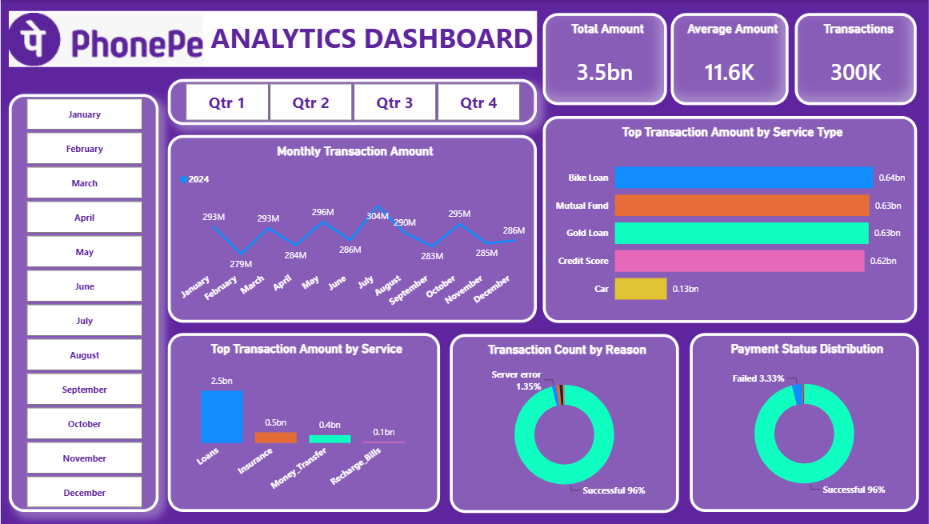

# 📊 PhonePe Analytics Dashboard

An interactive **Power BI dashboard** designed to analyze PhonePe transaction data and uncover meaningful insights into transaction trends, payment behavior, and overall digital payment performance.

---

## 📌 Project Overview

The **PhonePe Analytics Dashboard** is a data analytics and visualization project built using **Microsoft Power BI**.

The project transforms raw PhonePe transaction data into an interactive dashboard that helps users explore key business metrics and identify patterns across different transaction categories and time periods.

The dashboard provides a simple and visual way to understand transaction performance and derive actionable insights from the dataset.

---

## 🎯 Objectives

The main objectives of this project are:

- Analyze PhonePe transaction data
- Understand transaction trends over time
- Identify important transaction categories
- Compare transaction performance
- Create interactive and user-friendly visualizations
- Track important KPIs using Power BI
- Convert raw data into meaningful business insights

---

## 🛠️ Tools & Technologies

| Tool | Purpose |
|---|---|
| **Microsoft Power BI** | Dashboard development & visualization |
| **Power Query** | Data cleaning and transformation |
| **DAX** | Measures and calculated metrics |
| **Microsoft Excel** | Data storage and preprocessing |
| **Data Visualization** | Charts, KPIs and interactive analysis |

---

## 📂 Repository Structure

```text
phonepe_analytics_dashboard/
│
├── 📊 Dashboard_phonepe.png
├── 📁 Phonepe-Final-Dataset.xlsx
├── 📈 phonepe.pbix
└── 📄 README.md
```

### Files Description

- **`Dashboard_phonepe.png`**  
  Preview image of the completed Power BI dashboard.

- **`Phonepe-Final-Dataset.xlsx`**  
  Dataset used for analysis and dashboard creation.

- **`phonepe.pbix`**  
  Power BI project containing the data model, transformations, calculations, and dashboard.

---

## 📊 Dashboard Features

The dashboard focuses on presenting PhonePe data through interactive visualizations and KPIs.

### 🔹 KPI Analysis

Key performance indicators can be used to quickly understand:

- Total Transactions
- Transaction Value
- Transaction Volume
- Overall Performance

### 🔹 Transaction Analysis

The dashboard helps analyze:

- Transaction trends
- Transaction categories
- Transaction performance
- Changes across different periods

### 🔹 Interactive Visualizations

Power BI visualizations make it easier to:

- Compare categories
- Identify trends
- Analyze performance
- Explore the data interactively

### 🔹 Data Filtering

Interactive filters and slicers allow users to explore the dashboard according to different dimensions of the dataset.

---

## 🔄 Data Analysis Workflow

```text
Raw PhonePe Dataset
        ↓
Data Cleaning
        ↓
Data Transformation
        ↓
Data Modeling
        ↓
DAX Calculations
        ↓
Interactive Visualizations
        ↓
PhonePe Analytics Dashboard
```

---

## 🧹 Data Preparation

The dataset was prepared before creating the dashboard.

The data preparation process includes:

- Removing unnecessary data
- Handling missing values
- Checking data types
- Formatting columns
- Transforming data using Power Query
- Preparing the dataset for analysis

---

## 🧮 DAX & Calculations

DAX measures were used to create important analytical metrics and KPIs.

Example:

```DAX
Total Transactions =
SUM('Phonepe'[Transaction_Count])
```

Example for transaction value:

```DAX
Total Transaction Value =
SUM('Phonepe'[Transaction_Amount])
```

> Replace the column names above with the exact names used in your Power BI model if they differ.

---

## 📈 Key Insights

The dashboard can be used to identify:

- Overall transaction performance
- High-performing transaction categories
- Transaction trends over time
- Changes in transaction volume and value
- Patterns in digital payment activity
- Areas with higher transaction performance

---

## 🖥️ Dashboard Preview



---

## 🚀 How to Use the Project

### 1. Clone the Repository

```bash
git clone https://github.com/Sakshi-Singh-17/phonepe_analytics_dashboard.git
```

### 2. Open the Project

Navigate to the project directory:

```bash
cd phonepe_analytics_dashboard
```

### 3. Open the Power BI File

Open:

```text
phonepe.pbix
```

using **Microsoft Power BI Desktop**.

### 4. Explore the Dashboard

Use the available:

- Filters
- Slicers
- Charts
- KPIs
- Visual interactions

to explore the PhonePe dataset.

---

## 💡 Skills Demonstrated

This project demonstrates practical experience in:

- 📊 Data Visualization
- 📈 Business Intelligence
- 🧹 Data Cleaning
- 🔄 Data Transformation
- 🧮 DAX
- 🗂️ Data Modeling
- 📊 Dashboard Development
- 📑 Microsoft Excel
- ⚡ Power BI

---

## 🔮 Future Improvements

Possible improvements include:

- Adding more advanced DAX measures
- Adding geographical analysis
- Creating year-over-year growth metrics
- Adding drill-through pages
- Adding dynamic KPI cards
- Implementing more advanced tooltips
- Publishing the dashboard to Power BI Service
- Adding automated data refresh

---

## 👩‍💻 Author

**Sakshi Singh**

Aspiring Data Analyst interested in:

- Power BI
- SQL
- Python
- Excel
- Data Analytics
- Data Visualization

---

## ⭐ Support

If you find this project useful, consider giving the repository a ⭐ on GitHub.

**GitHub Repository:**  
https://github.com/Sakshi-Singh-17/phonepe_analytics_dashboard

---

### 📌 Project Type

**Data Analytics | Business Intelligence | Power BI | Data Visualization**

---
